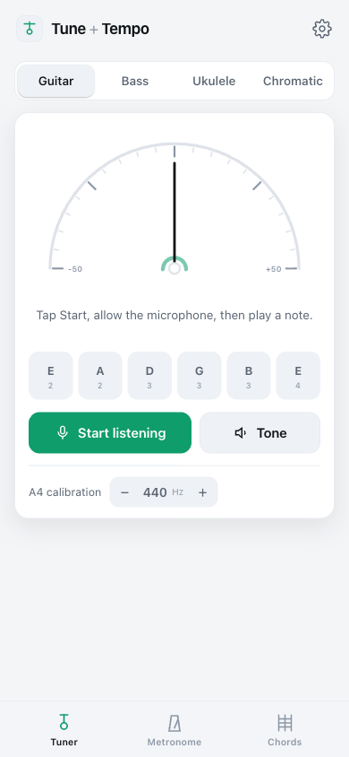
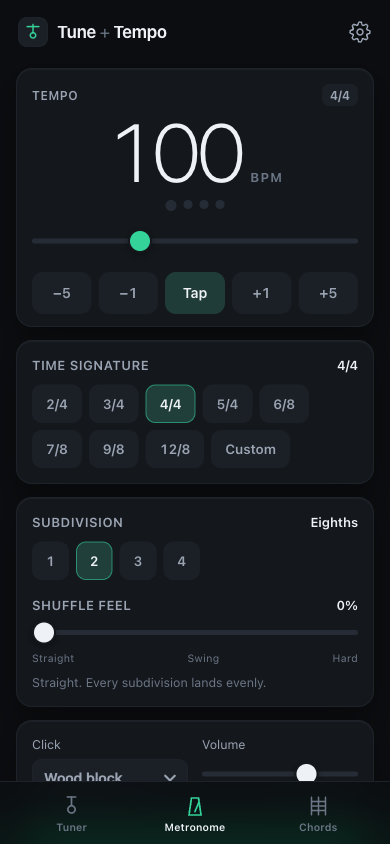
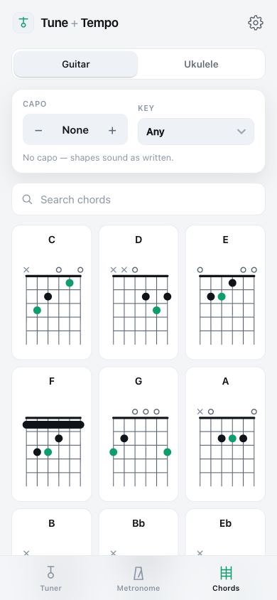
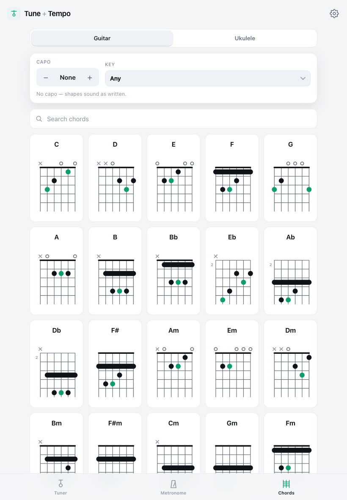
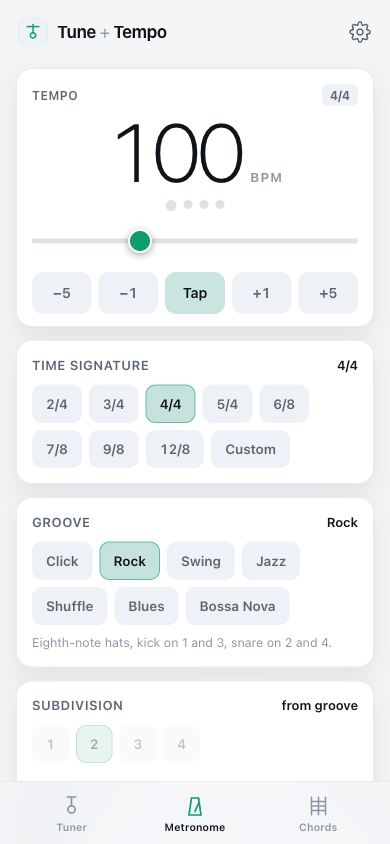

# Tune + Tempo

A guitar, bass and ukulele tuner with a shuffle-aware metronome and a 75-shape
chord library. One small web app, no build step, no accounts, no network calls
after the first load. Built for an iPhone first and a iPad too.



<p align="center">
  
  
  
</p>

## Run it locally

```bash
cd TuneAndTempo
python3 -m http.server 4173
```

Open <http://localhost:4173>. The microphone needs `localhost` or `https://` —
`file://` will load the interface but not the tuner.

## Put it on the phone

1. Host the folder somewhere over HTTPS. GitHub Pages, Netlify drop, Cloudflare
   Pages and Vercel all work with no configuration; the app is plain static
   files. Keep the folder structure intact.
2. On the iPhone or iPad open the HTTPS address **in Safari**.
3. Allow the microphone when the tuner asks. Do this before installing, so the
   permission is remembered for the installed app.
4. Share → **Add to Home Screen**.

After that first load every file is precached by `sw.js`, so the app opens and
runs with no connection at all.

## What is in it

### Tuner
- Guitar (EADGBE), bass (EADG), ukulele (GCEA, with a low-G switch) and
  chromatic.
- Autocorrelation pitch detection, ~20 reads a second, median-filtered so the
  needle does not twitch. Tested within ±0.3 cents from 30 Hz to 1047 Hz.
- A ±50 cent needle, a colour state (flat / in tune / sharp) and the nearest
  string highlighted as you play.
- Tap a string to lock onto it, tap again to go back to automatic.
- A4 calibration from 435 to 445 Hz, and a reference tone per string.
- The microphone is released the moment you leave the tuner, so the orange
  recording dot goes away.

### Metronome
- 30–250 BPM, slider, ±1/±5 steppers and tap tempo.
- 2/4, 3/4, 4/4, 5/4, 6/8, 7/8, 9/8, 12/8 and a custom signature (1–16 beats
  over 2, 4, 8 or 16).
- Subdivisions: quarters, eighths, triplets, sixteenths.
- **Seven grooves** — Click, Rock, Swing, Jazz, Shuffle, Blues and Bossa Nova.
  Drums are synthesised from oscillators and filtered noise, so there are no
  samples to download. Patterns are written on a 16th or triplet grid and tile
  to the bar, so the four-beat Rock pattern still works in 3/4 or 5/4.
- **Shuffle feel 0–100%.** Every second subdivision is pushed late by up to
  two thirds of a slot. 33% is the classic triplet swing, 50% a dotted feel,
  100% a hard shuffle. With a straight grid groove selected it swings that
  groove's off-8ths; triplet grooves are already swung, so the slider explains
  itself and switches off.
- Drum hits and clicks are scheduled on `AudioContext.currentTime` with a 25 ms
  lookahead, so the grid never drifts, even when the screen is busy. Grooves are
  scheduled one beat at a time, so Stop silences them within a beat. Beat dots
  and a tempo pulse show where you are.
- Three click sounds and a volume control.



### Chords
- 45 guitar shapes and 30 ukulele shapes, drawn as vector fretboards with
  muted/open markers, barre bars and root notes highlighted.
- **Capo 0–9, stored per instrument.** With a capo the card shows what you
  hear and which shape to finger: capo 2 shows the C shape as "D", with
  "C shape" underneath.
- **Key filter** (any of the 12 keys) shows only the shapes that sound in that
  key at the current capo, which is what makes 45 shapes usable on a phone.
- Tap a chord to open it full size with its notes, alternate shapes, and a
  strum button that plays it through the same audio context at the capo pitch.
- Search by shape name or sounding name.

## One sound at a time

There is a single `AudioContext`. Starting the metronome stops the microphone;
starting the tuner stops the click. Chord strums only sound while both are
stopped. Leaving a screen, or sending the app to the background, stops whatever
was running.

## Files

```
index.html            markup for all three views
styles/app.css        one stylesheet, dark/light, safe-area aware
js/main.js            boot, routing, metronome UI, settings
js/state.js           persisted settings + setup export/import
js/audio.js           shared AudioContext, clicks, tones, plucks
js/pitch.js           autocorrelation detector + smoothing
js/tuner.js           microphone pipeline and tuner screen
js/tuner-data.js      instrument string sets
js/metronome.js       lookahead scheduler and shuffle maths
js/grooves.js         drum patterns and bar tiling
js/chords.js          fretboard renderer and chords screen
js/chord-data.js      the 75 shapes and capo transposition
sw.js                 offline cache
manifest.json         install metadata
icons/                generated PNG icons
tools/make-icons.mjs  regenerates the icons (node tools/make-icons.mjs)
```

## Editing it

- **Bump `VERSION` in `sw.js` after changing any file.** The cache serves the
  old copy instantly and refreshes in the background, so a release only shows
  up on the second launch. Bumping the version is the clean way to ship.
- While editing, open `http://localhost:4173/?nosw=1` to skip the service
  worker entirely.
- Settings → *Back up your setup* turns your tempo, signature, capo and tuning
  into a `TT1:…` string you can paste back later.

## Honest limits

- Microphone access, and every iOS audio API, require HTTPS. That is an iOS
  rule, not a choice here.
- On some iOS versions a home-screen web app cannot open the microphone even
  though the same page works in Safari. If that happens, allow the mic in
  Safari first, then reinstall the home-screen icon.
- Finger numbers are a hint, not a lesson: they are computed from the shape,
  not from a teacher's fingering, and they are off by default.
- Tab-symbol metadata and iOS icon rendering vary; the icons are plain PNGs so
  every version agrees.
- Chord transposition spells notes with sharps. Capo 3 on Bb reads as C#, not
  Db. The pitch is right; only the spelling is opinionated.
